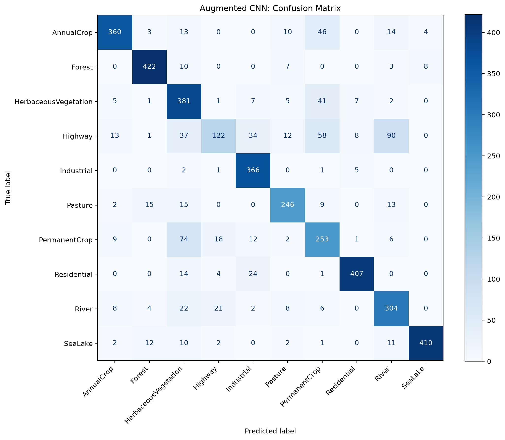
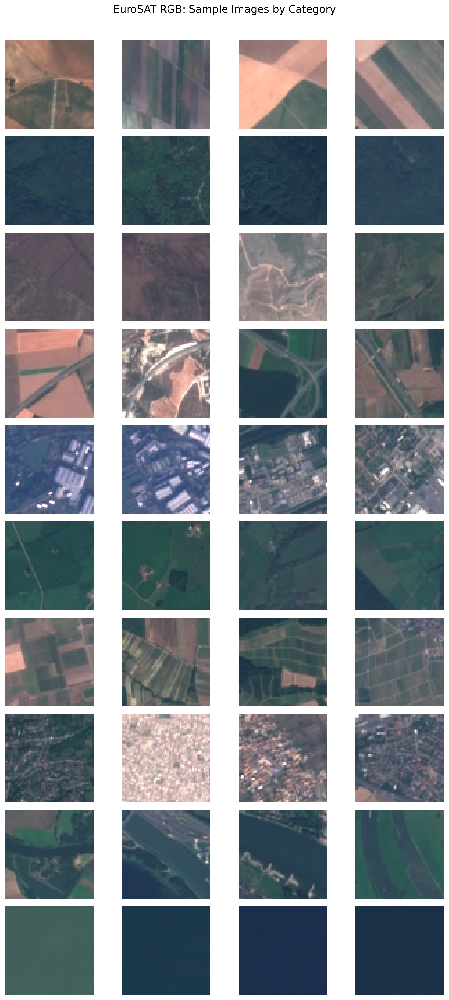

# Satellite Land-Cover Classification

**A CNN image-classification project using EuroSAT satellite imagery**


> **27,000 images · 10 land-cover classes · 80.77% test accuracy**

I built a compact convolutional neural network (CNN) to recognise ten types of land cover in satellite images. I used **PySpark** to explore the data, **TensorFlow/Keras** to train the model, and a second experiment to test whether image augmentation could improve its results.

## Results at a glance

| Measure | Result |
|:--|--:|
| Baseline validation accuracy | 76.42% |
| Augmented validation accuracy | **79.26%** |
| Validation improvement | **+2.84 percentage points** |
| Final test accuracy | **80.77%** |
| Macro F1-score | 79.42% |
| Correct test predictions | **3,271 / 4,050** |

The augmented model performed better on validation images, so I chose it for the final test. **Forest, Residential and SeaLake** were among the strongest classes. **Highway** was the hardest: the model recognised only **32.53%** of Highway test images.



*Figure: Confusion matrix for the final CNN on the held-out test set.*

## What I did

1. **Checked the data:** Verified the images, reviewed class sizes, inspected examples, and checked for exact duplicates.
2. **Explored patterns:** Used Python and PySpark to compare image brightness, contrast and class distribution.
3. **Prepared the images:** Kept the original 64 × 64 RGB images, scaled pixel values to 0–1, and created stratified **70/15/15** training, validation and test splits.
4. **Trained a baseline:** Built a three-convolution-layer CNN with **102,154 trainable parameters**.
5. **Tested an improvement:** Added training-only random flips and rotations, then compared the models using validation results.
6. **Evaluated the final model:** Examined accuracy, class-level precision/recall/F1, confusion patterns and prediction scores.

### Dataset examples



*Figure: Examples from the EuroSAT RGB land-cover categories.*

## Dataset and tools

The [EuroSAT RGB dataset](https://zenodo.org/records/7711810) contains **27,000 labelled Sentinel-2 satellite images**, grouped into ten classes. Each image is **64 × 64 pixels**. The raw images are **not included** in this repository; download them from the source above.

**Tools:** Python 3.12 · Apache Spark / PySpark · TensorFlow / Keras · NumPy · Pandas · Pillow · Matplotlib · Scikit-learn · JupyterLab

## Run the notebook

The project was developed with **Anaconda on Windows**. The notebook may need small environment-specific adjustments on other systems.

1. Clone or download this repository, then open a terminal in its main folder.
2. Create and activate a Conda environment:

   ```bash
   conda create -n eurosat_cnn python=3.12
   conda activate eurosat_cnn
   ```

3. Install the dependencies and JupyterLab:

   ```bash
   python -m pip install -r requirements.txt
   python -m pip install jupyterlab
   ```

4. Install a **Java runtime compatible with PySpark 4.2** and ensure Java is available on your system.
5. Download the **EuroSAT RGB ZIP archive** from [Zenodo](https://zenodo.org/records/7711810) and save it as:

   ```text
   data/raw/EuroSAT_RGB.zip
   ```

6. Start JupyterLab from the project root:

   ```bash
   jupyter lab
   ```

7. Open [`notebooks/PDAN8412w_Part3_CNN_EuroSAT.ipynb`](notebooks/PDAN8412w_Part3_CNN_EuroSAT.ipynb) and run the cells in order.

**Note:** Training the models again can produce slightly different results. The original model checkpoints are not included in the public repository.

## Project files

| Location | Contents |
|:--|:--|
| [`notebooks/`](notebooks/) | Full investigation, code, explanations and saved outputs |
| [`reports/`](reports/) | Final academic PDF report |
| [`figures/`](figures/) | Data exploration and model evaluation charts |
| [`data/processed/`](data/processed/) | Saved image metadata, data splits and model results |
| [`environment/`](environment/) | Original Conda package record |
| [`requirements.txt`](requirements.txt) | Main Python dependencies |

## Limitations and next steps

The dataset lacks the location information needed to check whether images from nearby places were split across training and testing. Each model was trained once, and the CNN was tested only on EuroSAT. Its output scores were not formally calibrated.

Next, I would explore **transfer learning**, **geographically separate test data** and **better recognition of the Highway class**.

---

**Tumisi Mosoeu** · Postgraduate Diploma in Data Analytics · **PDAN8412/w — POE Part 3 (2026)**

Dataset reference: Helber, P., Bischke, B., Dengel, A. and Borth, D. (2019). [EuroSAT: A novel dataset and deep learning benchmark for land use and land cover classification](https://doi.org/10.1109/JSTARS.2019.2918242). Full academic references are provided in the notebook and PDF report.
